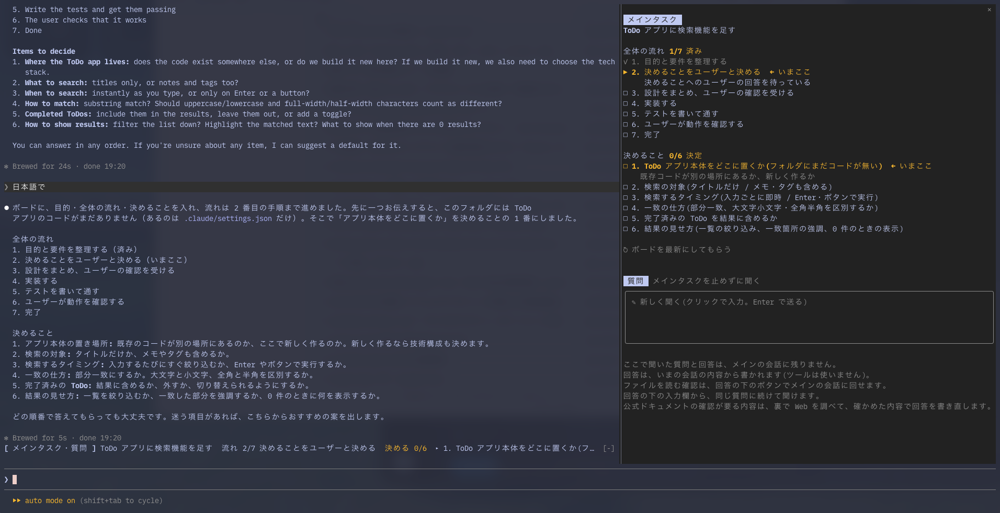

# main-task-board

Claude Code の画面に、次の 2 つを足す mod(Claude Code の画面と動きを変える拡張)。

- **メインタスクのボード**: 作業の目的、全体の流れ、決めることを、入力欄の上とパネルに固定表示する
- **質問**: 作業を止めずに、理解のための質問をパネルで聞く。質問と回答はメインの会話に残らない

長い作業で質問のやり取りが続くと、何を決めている途中だったか、全体のどこまで進んだかが画面の上へ流れてしまう。この mod は、その現在地を画面に留めておく。

A Claude Code mod that pins a main-task board (goal, steps, open decisions) above the prompt and in a side pane, and lets you ask side questions without adding them to the main conversation. The interface text is in Japanese.

## 入れ方

ターミナルの Claude Code の入力欄で、次の 1 行を打つ。

```
/plugin install main-task-board --marketplace YusukeHayashiii/main-task-board
```

シェルから入れるときは、次のとおり。

```
claude plugin install main-task-board --marketplace YusukeHayashiii/main-task-board
```

## 画面



全画面の表示で、パネルを会話の横に出したところ。

- 入力欄の上に 1 行が出る。左に「メインタスク・質問」のボタン、続けてメインタスクの要約(目的、流れの現在地、決めることの数)
- ボタンを押すと、パネルが開く。上から「メインタスク」「質問」の順に並ぶ
- コマンドでも開ける。`/now` はパネルを開く。`/ask 質問の文` は質問を送ってパネルを開く

パネルの出る場所は、Claude Code の表示のしかたで変わる。

- 全画面の表示(settings.json に `"tui": "fullscreen"`)では、会話の横に出る。ターミナルの幅が 110 文字ぶん以上要る
- 通常の表示では、入力欄のすぐ上に出る。パネルのいちばん上に、横に出す方法が 1 行で出る

ボードに初めて中身が入ると、パネルが自動で開く。全画面の表示で自動で開くには、幅が 144 文字ぶん以上要る。開かなかったときは、画面を広げて `/now` を打つ。

`/now` か `/ask` という名前のコマンドを別の mod が先に登録していると、その名前のコマンドはこの mod のものにならない。その場合も、入力欄の上のボタンからパネルを開ける。

## メインタスクのボード

| 項目 | 中身 |
|---|---|
| 目的 | 作業の目的を 1 行で |
| 全体の流れ | 最初から最後までの手順。済んだ手順は ✓ が付いて字が薄くなり、いまの手順には ▶ と「← いまここ」が付く。これからの手順は □ |
| 決めること | 未決(□)、仮決め(△)、返事待ち(…)、決定(✓)。決まったものには、選んだ案が下に出る |

- ボードを書き換えるのは Claude。mod がボードを更新するツール(`mcp__main-task-board__board`)を足し、いつ更新するかをシステムプロンプトに書き足している
- `/now` は表示するだけで、更新はしない。実態とずれていたら、ボードの下の「↻ ボードを最新にしてもらう」を押す。入力欄に依頼の文が入るので、Enter で送る
- セッションを再開すると、保存してあるボードが戻る(直近 20 セッション分)
- 会話が要約されるときは、ボードの中身を要約に残すよう指示を足す

## 質問

- パネルの「✎ 新しく聞く」の欄に書いて Enter で送る。`/ask` でも送れる
- 回答は、その時点の会話の内容だけから書かれる。ツールは使わないので、ファイルや Web は読まない。聞かれたことだけを 5 行ほどで答えるよう指示している
- 回答の下の「✎ この質問に続けて聞く」の欄から、同じ質問の続きを聞ける。前の質問と回答が一緒に渡るので、「それ」「さっきの」で聞ける
- 回答の下の「メインの会話で確かめる」を押すと、質問がメインの入力欄に入る。ファイルを読まないと分からないことに使う
- 質問と回答は Claude の会話には入らない。質問の内容に触れるときは、Claude に言い直す

## 設定

`/config` から変えられる。どれも既定では空かオフで、入れただけではファイルを作らず、別のセッションも起動しない。

| 項目 | 既定 | 内容 |
|---|---|---|
| 読む人の説明(`reader`) | 空 | 質問の回答を書くモデルに伝える、あなたについての 1 文。例: 「SQL は書ける。フロントエンドには慣れていない」 |
| 質問ログのフォルダ(`askLogDir`) | 空 | 入れると、質問と回答をそのフォルダの `YYMMDD_質問ログ.md` に追記する。プロジェクトのルートから見たパスか、`/` で始まる絶対パス。日付は日本時間 |
| 回答を Web の原文で確かめる(`webCheck`) | オフ | 下の節を参照 |

### 回答を Web の原文で確かめる

オンにすると、回答が「原文で確かめること: 〜」という行を書いたときに、mod が裏で別のセッション(`claude -p`)を起動する。別のセッションは Web の検索と取得だけを使って公式ドキュメントなどを読み、回答を書き直す。パネルでは、最初の回答が「原文で確かめた回答」に置き換わる。最初の回答は「最初の回答も出す」のボタンで出せる。

オンにする前に、次の点を確かめる。

- 別のセッションの分の費用と時間がかかる(1 回の確認に数十秒から数分)
- 質問の文と最初の回答が別のセッションに渡り、Web の検索に使われる。外に出せない内容は質問に書かない
- `claude` コマンドが使えることと、Web の検索と取得が使える設定であることが要る

## 動く条件

- ターミナルの Claude Code で動かして確かめている。ほかの画面(デスクトップアプリなど)では確かめていない
- 画面の無い起動(`claude -p`)では、mod はコマンドもツールも足さない

## 直すとき

- `claude plugin validate <このフォルダ>` と `claude plugin test <このフォルダ>` を通す
- 型検査は、Claude Code がこのフォルダに `.claude-plugin/types/` を書いた後に `npx -p typescript@5.6 tsc -p <このフォルダ>` で行う

## ライセンス

MIT License。`LICENSE` を参照。
